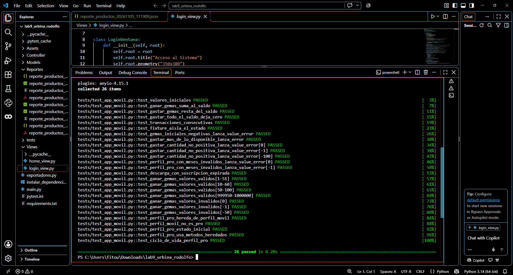

# Lab 10. Automated Testing with pytest

**Alumno:** Urbina Avitia Rodolfo — 4A BIS TI

Pruebas unitarias automatizadas con pytest sobre el proyecto del Lab 9.

- `Models/app_movil.py` — `PerfilMovil`, `PerfilPro` y las excepciones `SuscripcionExpiradaError` y `PuntosInsuficientesError`.
- `tests/test_app_movil.py` — fixtures, asserts, `pytest.raises`, `@pytest.mark.parametrize` e `isinstance`.

## Cómo ejecutar

```
py -m pip install pytest
py -m pytest -v
```

## Evidencia


